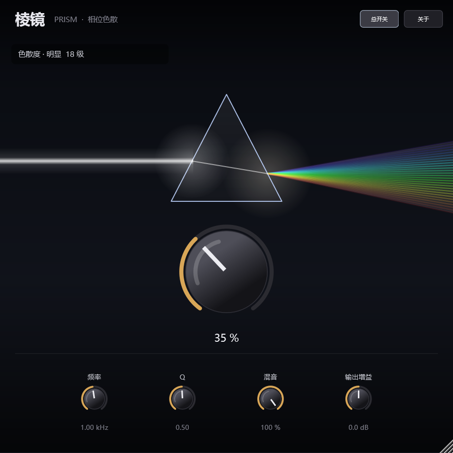
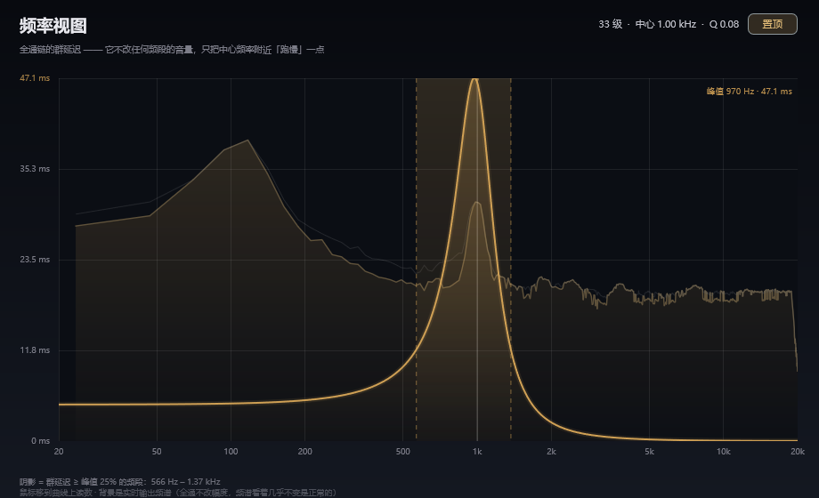
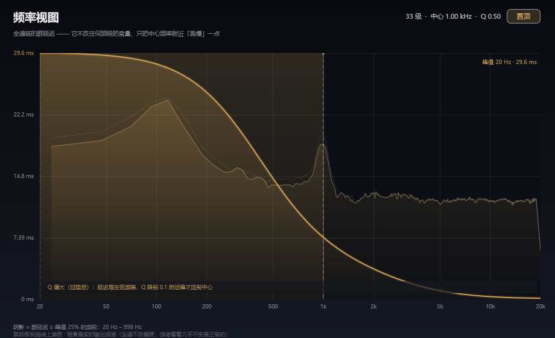

# 棱镜 / Prism

> 一条全通滤波器链，不改变音量，只让不同频率跑出不同的时间差。

**VST3 / Standalone · Windows · JUCE 8 · GPLv3**

作者：**Yunshu_TSK** · [Bilibili](https://space.bilibili.com/1394063758)



## 它做什么

把信号串过一长串双二阶全通滤波器。全通**不改变幅度谱**，只改相位：
每一级都在中心频率附近给出一段群延迟，几十级叠起来，瞬态被抹开、高频跑到低频前面。

听感：

- 鼓组 → 像一层沙，attack 被拉软
- 贝斯 / sub → 黏稠的拖尾
- 合成器 pluck → 金属味的 "zap"

**它不可能既保留瞬态原貌又产生色散**——这是效果的物理本质，不是 bug。

## 频率视图

右上角「频率视图」会**另开一个窗口**：横轴 20 Hz–20 kHz 对数频率，纵轴是整条全通链的
**群延迟**（每个频率被拖慢多少毫秒）。



- 欠阻尼（Q 小）时，曲线峰值落在「频率」旋钮的位置，两侧快速回落 —— 这就是被"捏"得最狠的频段
- 阴影 = 群延迟 ≥ 峰值 25% 的频段，窗口底部直接写出上下限
- 鼠标移到曲线上：读出「频率 · 延迟 · 级数」
- 背景是实时输出频谱：全通**不改变幅度**，所以频谱看着几乎不变是正常的，改的只有时间

**Q 不只调峰宽，也调峰的位置。** Q 越大，分母的阻尼越大，两个极点从共轭复数分裂成实数
（过阻尼），整条全通链退化成"低频转得多、高频转得少"，群延迟峰就掉到 20 Hz 附近；
Q 降到 0.1 附近才会在中心频率处重新出现那个尖峰。默认 Q=0.5 时窗口会如实画出低频堆积，
并给出提示 —— 那个设置本来就是偏"贝斯胶水"的，不是显示错误。

为什么不画普通频谱图：全通的幅度谱是平的，频谱上什么都看不出来；真正被改动的是相位，
能被听见的后果就是群延迟。演示时想让观众"看见"色散，看这张图比看频谱直观得多。

窗口跟编辑器的寿命绑定：点 ✕ 只是隐藏，编辑器关掉时一起销毁；缩放窗口时坐标轴和字跟着走。
窗口**默认置顶**（右上角「置顶」可以关掉）—— 否则点回效果器时，它会被宿主的 FX 窗口盖住。

Q=0.5（默认）时它是这个样子的 —— 群延迟峰不在 1 kHz，而在最左边的低频端：



## 参数

| 参数 | 范围 | 说明 |
|---|---|---|
| **强度** | 0–100% | 串联级数 0–50，0 = 旁通 |
| **频率** | 20 Hz–20 kHz | 色散中心。它附近的频率被"捏"得最狠 |
| **Q** | 0.02–1.0 | 越小越集中在中心频率、色散越强；≥0.35 会变成过阻尼，延迟堆到低频端 |
| **混音** | 0–100% | 干湿。**默认 100%（纯湿）**；30–70% 之间会与干声抵消出很深的梳状凹陷 |
| **输出增益** | ±24 dB | 仅用于 A/B 对齐响度 |
| **总开关** | on/off | 旁通（逐样本直通）。关闭时界面上的光谱会收回棱镜 |

旋钮：双击复位，Ctrl / Alt + 拖动精细调节。

界面按 720×720 设计稿整体等比缩放，窗口可从 480 拉到 1200，字和控件一起缩放。

## 视觉

背景是**程序化绘制**的，没有图片素材：

- 白光从左射入棱镜，右侧散成 28 条光谱射线
- **频率**决定光束打在棱镜的高度（低频在下、高频在上）
- **强度**决定扇面张角
- **Q** 决定射线粗细
- **混音**决定光谱浓度
- **输出电平**驱动光束亮度与入射光斑大小

右上角「关于」里有一个实时频谱（FFT 2048，对数频率轴）。

## 编译

依赖：

- Windows 10/11
- [Visual Studio 2022 Build Tools](https://visualstudio.microsoft.com/downloads/)（勾选「使用 C++ 的桌面开发」）
- CMake 已随 VS 一起安装

```powershell
git clone https://github.com/<you>/prism.git
cd prism
powershell -NoProfile -ExecutionPolicy Bypass -File .\tools\build.ps1
```

首次配置会通过 `FetchContent` 下载 JUCE 8.0.9（需要网络）。如果本地已有 JUCE：

```powershell
powershell -NoProfile -ExecutionPolicy Bypass -File .\tools\build.ps1 -JuceDir D:\JUCE
```

产物：

| 目标 | 路径 |
|---|---|
| VST3 | `build/Prism_artefacts/Release/VST3/Prism.vst3` |
| Standalone | `build/Prism_artefacts/Release/Standalone/Prism.exe` |
| DSP 自检 | `build/PrismSelfTest.exe` |
| 界面回归 | `build/PrismEditorProbe.exe` |

装到 DAW：把 `Prism.vst3` 复制到 `C:\Program Files\Common Files\VST3\`，或在 DAW 里把构建目录加进插件扫描路径。

## 测试

```powershell
# DSP：幅度平坦度、极端参数不发散、reset 静音、干湿梳状深度、
#      群延迟公式 vs 相位差分、频率视图的曲线/受影响频段
build\PrismSelfTest.exe

# 界面/旁通回归：宿主 program 回调、打开关闭界面、关于面板、频率视图窗口、
#                旁通逐样本直通、频谱数据通路
build\PrismEditorProbe.exe
```

`PrismEditorProbe.exe` 还会在构建目录渲染几张图：`ui-freq-*.png`（主界面）、
`ui-frequency-view.png`（频率视图）、`spectrum-test.png`（频谱）。

自检的核心判据是**幅度守恒**：全通不改变幅度谱，所以湿信号 RMS 必须等于干信号
（50 级时实测 0.986，差 1.4% 来自起始瞬态）。

## 已知限制

- 混音 / 输出增益在块边界瞬跳（频率 / Q 已按 32 采样重算系数，不再有 zipper）
- `getTailLengthSeconds()` 报 0.5s，离线渲染会砍掉更长的尾巴（低中心频率 + 大 Q 时群延迟可以到几百毫秒）
- 192 kHz 下全通延迟会超出缓冲长度
- 总开关是硬切，没有交叉淡入
- 频率视图的「受影响频段」用峰值 25% 作阈值，是个显示约定，不是声学标准

## 许可证

**GPLv3**。用 JUCE 8 的免费版本就意味着整个插件必须是 GPLv3——
你可以自由使用、修改、再分发，但衍生作品也必须开源。

Copyright (C) 2026 Yunshu_TSK

## 致谢

- 本插件的代码 100% 由 **DeepSeek 4.1 Flash** 编写（AI 协作，人类负责需求、验收与试听）
- [JUCE](https://juce.com/) — 框架（GPLv3 / 商业双许可）
- [AllPassPhase](https://github.com/enummusic/AllPassPhase) by **enummusic** — 这个插件的 DSP 思路来源。
  本项目的引擎是按算法重写的（RBJ cookbook 的 all-pass 形式），**没有使用其代码**，
  但采样率处理、平滑等细节参考了它的行为。
- RBJ Audio EQ Cookbook — 双二阶滤波器系数公式
